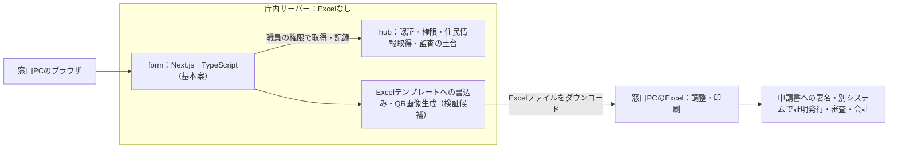

# MADO-form

> OSS版は設計議論の段階です。以下は業務上の要求と構成の基本案であり、実装済みの機能説明ではありません。

窓口の職員が住民情報を使って申請書を作成し、住民が同じ情報を繰り返し書く負担を減らすためのパッケージです。芽室町の業務フローと要求を土台に、画面・hub連携・Excel帳票の実現方法を相談します。

## 最初に見てほしい資料

- [業務フロー](../../docs/form/workflow.html)：本町の現行運用と、数量変更時の会計の運用案。HTMLは保存してブラウザで開けます。
- [方針・要求と構成の基本案](../../docs/form/requirements-and-design.md)：実現したいこと、前提、未決事項。
- [動画・帳票・現行コードの案内](../../docs/form/materials.md)：現在の動きを理解するための資料。
- [設計議論の入口：Issue #6](https://github.com/Memuro-Town/MADO-packages/issues/6)。

動画・Excel帳票・参考コードは掲載準備中です。現行版の説明資料として用意し、OSS版で現行の実装を継続採用するかは相談対象とします。

## 現状と目指す流れ

庁内の現行版は、Pythonのデスクトップ画面でDBを直接検索し、Excelアプリを操作して帳票へ転記する方式です。OSS版のアプリコードはまだありません。

目指す流れは、窓口PCのブラウザで検索・入力・確認し、Excel申請書をダウンロードして、PCのExcelで調整・印刷する形です。住民票などの証明書自体の発行は、別の基幹システムや戸籍システムで行います。

- 利用者は住民窓口・税務窓口の職員。住民が入口タブレットで入力する構成は今回の対象に含めません。
- サーバーにはExcelをインストールしません。窓口PCにはExcelがある前提です。
- 本町で使えるものを起点にし、他自治体が変える箇所と制約も分かるようにします。
- 署名・紙の確認シート・トークスクリプトと併用し、全手順を画面へ詰め込みません。

## 構成の基本案

hubに合わせ、Next.js＋TypeScriptを基本案にします。Excelへの書込み・ダウンロードとQR生成もTypeScriptを候補とし、モックアップで実現性を確認します。Pythonを採用するかどうか自体も相談対象です。

この図は責任の分け方の基本案です。庁内ネットワークのサーバー側で動かす前提で、hubとformを同じサーバー・同じプロセスにするか等の具体的な配置、認証の共有方法、APIとデータ形式は未決です。hubの現在の監査機能だけで、formの帳票出力まで記録できることを意味しません。

現行PythonのExcel操作はExcelアプリに依存しています。その処理をサーバーへそのまま移す前提にはしません。転記項目・処理内容を知る参考にし、採用する実装方法は運用・保守負担も含めて比較します。

## 最初に相談したいこと

**この業務フローと要求に対し、この役割分担で無理なく実現できるでしょうか。改善案と、モックで先に確認すべき点について意見をいただきたいです。**

特に、次の観点が入口になります。答えられるところだけでも歓迎します。

- hubの認証・権限・情報取得・監査を、formへどうつなぐか。
- Excelがないサーバーで、既存帳票をどこまで活かせるか。数式・印刷設定・QRをどう扱うか。
- Next.js／TypeScriptを基本とした場合の利点・制約と、別方式を使う理由。
- 他自治体の様式や品番・案内文の変更を、どこまで設定・テンプレートで扱うか。

## 数量変更とQRの運用案

住民票では、申請書の署名をお願いしている間に職員が住民票の作成を進めます。署名依頼の時点で、発行結果の枚数や会計数量が最終確定していない場合があります。

後から数量が変わる場合は、当初のQRを使って追加分をPOSのボタンで加える、またはQRを使わずボタン操作で会計する案です。申請書は紙で訂正し、Excel再出力・QR再生成を必須としない方向で検討します。

この運用を踏まえ、ダウンロード時にQR画像を埋め込む案も候補になります。生成場所・数量入力の場所は未決です。帳票の数式やActiveX部品を保持できるか、POSで正しく読めるかは未検証です。

ただし、現行のようにExcelで最初の部数を入力する場合、ダウンロード時にはQRに使う数量がまだ決まっていない場合があります。また、埋め込んだQR画像は、その後のセルの数量変更には自動追従しません。最初の数量をどこで入力するか、品番・料金・POS用文字列の組立てをどこが担うか、QRをどの時点で作るかを、初回モックの確認事項とします。これは発行後の数量変更をPOSで扱う運用とは分けて検討します。

## 進め方と参加方法

formの構成や仕様については、共創PFでテーマごとに相談しています。

最初に全設計を固定せず、方向が見えたところからモックアップを作り、架空データで業務の流れを試して更新します。画面の見た目だけでなく、ダウンロードしたExcelの再計算・調整・印刷、QRと会計まで確認します。

提案・未決事項・決定とその理由はGitHubへ整理します。整理担当、判断方法、反映のタイミングは相談して決めます。コードPRの期限は設けず、方向が見えた箇所への小さな実装提案も歓迎します。実装は別Issueへ分けます。

設計相談後、一定期間コントリビューションがなければメンテナー側で実装に着手する、という従来の進め方を基本とします。具体的な期間・着手範囲は今回の締切として固定せず、Issueで案内します。

参加時の共通方針は [CONTRIBUTING](../../CONTRIBUTING.md) を参照してください。実在の住民情報・接続情報は投稿しないでください。

## 関連リンク

- [MADO-packages](../../README.md)
- [hub](../hub/README.md)
- [MADOの目的と方針](https://github.com/Memuro-Town/MADO)
- [MADO-queue](https://github.com/Memuro-Town/MADO-queue)：個人情報を扱わない、別系統の番号発券。

Licenseはリポジトリ全体と同じ [MIT](../../LICENSE) です。
